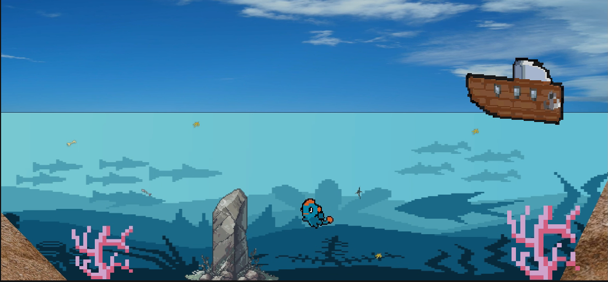

# Deep Remains

Videojuego 2D en pixel art ambientado en el fondo del mar, desarrollado en **Unity 6** como proyecto universitario.



## Sobre el juego

Un pequeño pez recorre el fondo del océano, entre corales y restos de basura que flotan en el agua, mientras en la superficie navega un barco.

## Estado del proyecto

El proyecto está en desarrollo. Hoy incluye:

- **Menú principal** con las opciones *Jugar*, *Opciones* y *Salir*.
- **Menú de opciones** para cambiar la calidad gráfica y activar la pantalla completa.
- **Escena de juego** con el escenario submarino.
- **Sprites y animaciones en pixel art** hechos en Aseprite:
  - El pez, en reposo y en movimiento hacia la izquierda y la derecha.
  - El barco, con sus estados normal, recibiendo impacto y dañado.
  - Dos enemigos.
  - Basura marina: manzanas, bananos y espinas de pescado.

## Tecnologías

| Herramienta | Uso |
|---|---|
| Unity 6 (6000.2.5f1) | Motor del juego |
| C# | Lógica (por ejemplo, la navegación del menú en `MenuInicial.cs`) |
| Universal Render Pipeline 2D | Renderizado |
| Input System | Controles |
| TextMesh Pro | Textos de la interfaz |
| Aseprite | Sprites y animaciones en pixel art |
| 2D Tilemap | Construcción del escenario |

## Cómo abrir el proyecto

1. Instala **Unity Hub** y la versión **6000.2.5f1** del editor.
2. Clona el repositorio:
   ```bash
   git clone https://github.com/Samuelc16/DeepRemainsProyect.git
   ```
3. En Unity Hub, selecciona **Add → Add project from disk** y elige la carpeta clonada.
4. Abre la escena `Assets/Scenes/MainMenu.unity` y presiona **Play**.

La primera vez Unity tarda unos minutos, porque regenera la carpeta `Library`, que no se sube al repositorio.

## Estructura

```
Assets
├── Scenes          # MainMenu (menú) y SampleScene (juego)
├── Scripts         # Código C# del juego
├── Sprites         # Personajes, enemigos, basura y escenario (Aseprite y PNG)
├── Settings        # Configuración de URP 2D
└── TextMesh Pro    # Fuentes y recursos de texto
Packages            # Paquetes de Unity usados
ProjectSettings     # Configuración del proyecto
```

## Créditos

- Autor: **Carlos Samuel Camelo**.
- Recursos gráficos y musicales de apoyo: *Sunny Land* de Ansimuz.
